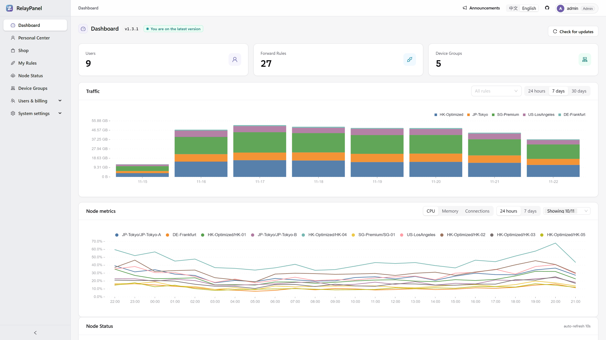
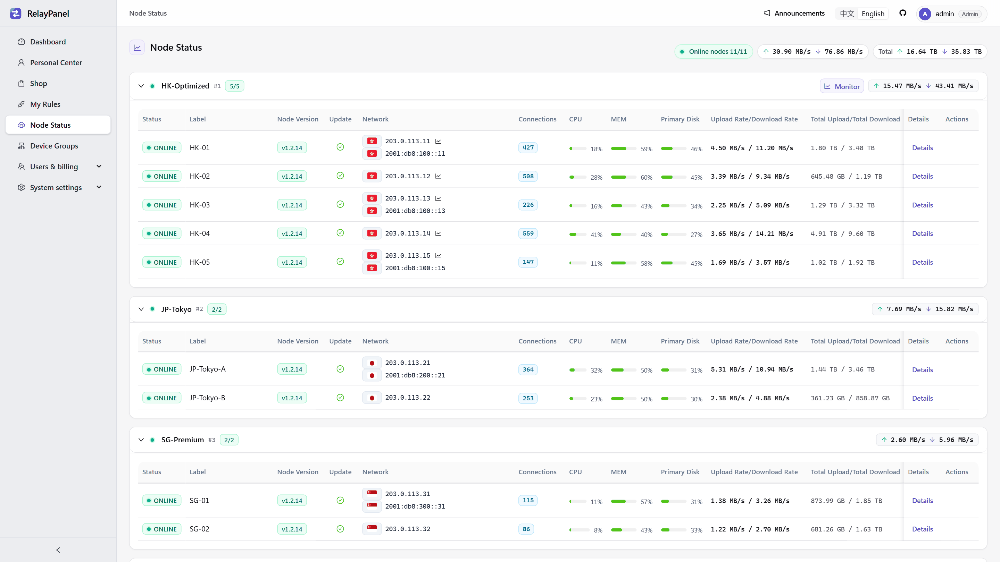
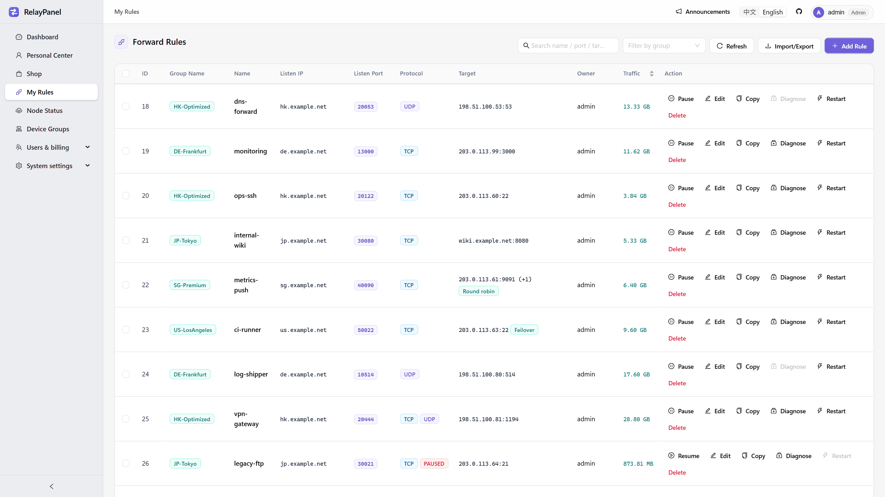
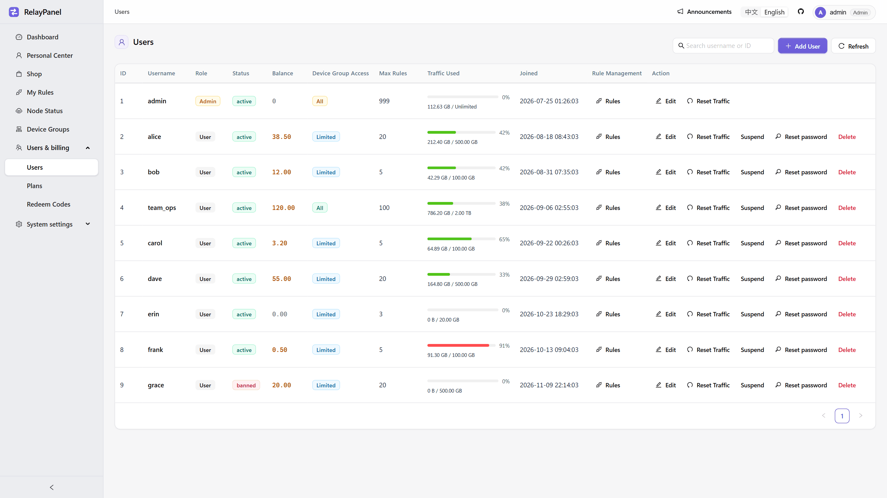
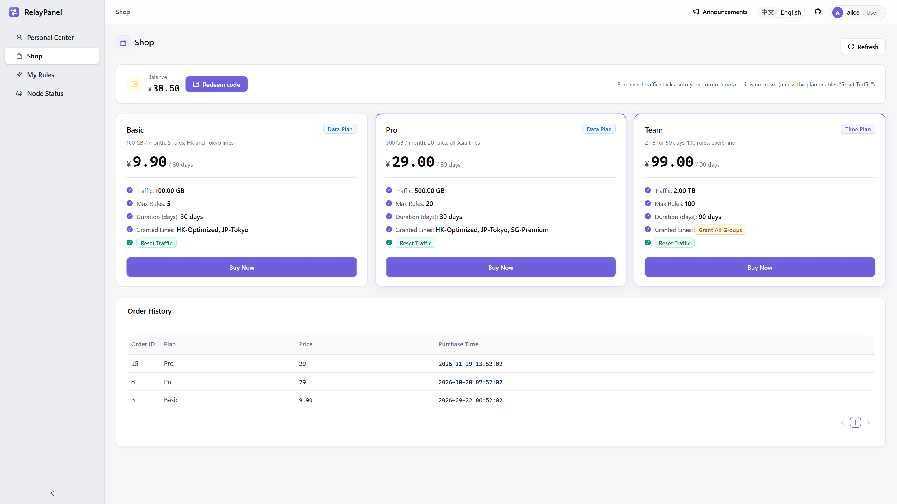
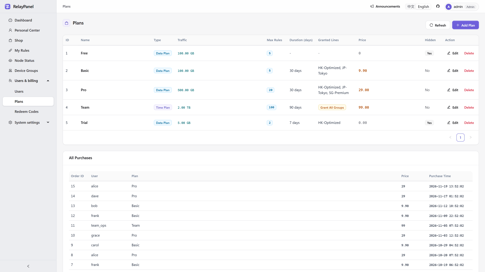
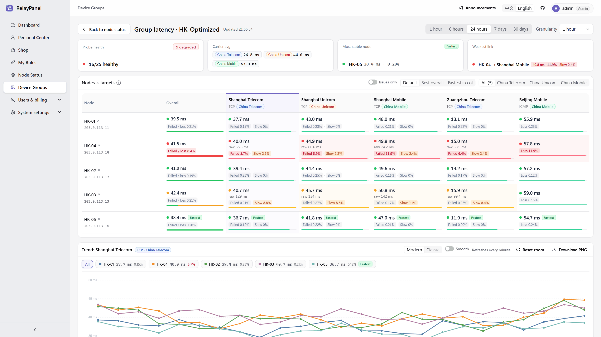

<p align="center">
  
</p>

<h1 align="center">RelayPanel</h1>

<p align="center">
  <strong>Self-hosted TCP/UDP Port Forwarding &amp; Traffic Management Panel</strong>
</p>

<p align="center">
  <strong>English</strong> · <a href="README.zh-CN.md">简体中文</a> · <a href="https://relaypanel.dev">Documentation</a>
</p>

<p align="center">
  <a href="https://github.com/MoeShinX/relay-panel/releases/latest"></a>
  <a href="https://github.com/MoeShinX/relay-panel/actions/workflows/ci.yml"></a>
  <a href="LICENSE"></a>
  <a href="https://relaypanel.dev"></a>
</p>

<p align="center">
  Written in Rust with a React web UI. Manage TCP/UDP forwarding rules, device groups, traffic quotas,
  billing plans, and live node telemetry from one lightweight panel.<br/>
  <strong>Panel ~7 MB + Node ~4 MB</strong> · Docker Compose · SQLite / PostgreSQL · amd64 &amp; arm64
</p>

---

## Features

### Forwarding & Connection Control
- **Multi-target TCP/UDP forwarding** — Failover and round-robin load balancing, circuit breaker with automatic recovery, and domain targets that track DDNS updates.
- **PROXY protocol & chained relays** — Preserve the real client IP across single-hop or node-to-node forwarding chains.
- **Traffic & connection governance** — Per-rule upload/download rate limits, concurrent connection caps, shared node-wide file-descriptor budget, one-click diagnostics, and single / batch / scheduled rule restarts (dropping stale connections and rebuilding listeners).
- **Loopback guard** — Node-side DNS-resolved loopback and link-local blocking for regular users' rules.

### Node Fleet & Network Monitor
- **Live node telemetry** — Real-time CPU (with model), memory, disk, upload/download rate, relay connections (plus admin-only host TCP/UDP counts on Linux), region detection, and Telegram / email offline alerts.
- **One-click node upgrades** — Upgrade systemd forwarding nodes directly from the panel with zero SSH and a graceful 5-second connection drain.
- **Network Monitor** — Scheduled multi-carrier TCP and ICMP probing per device group, tracking latency, packet loss, and slow handshakes in a comparison matrix with health overview cards, overall ranking, per-node trend focus, and recent-status strips.

### Users, Billing & Traffic Analytics
- **Plans & billing** — Self-service plan store, redeem-code balance top-ups, and configurable line-multiplier accounting (`(upload + download) × line rate`). Renewals stack; switching plans replaces cleanly.
- **Per-rule & per-user traffic charts** — 1 / 7 / 30-day charts stacked by line so you can see exactly which route consumes quota.
- **Flexible Device Groups & user admin** — Manage any user's rules, plan, password, or ban status; hide device groups; remove or replace nodes without losing rules.

### Lightweight, Portable & Secure
- **Minimal footprint** — Rust (Axum + Tokio + sqlx) backend and static node binary; runs smoothly on `linux/amd64` (including older CPUs without AVX2) and `linux/arm64`.
- **Zero-config or production DB** — Start with embedded SQLite (automatic pre-upgrade backups) or connect to PostgreSQL.
- **Built-in HTTPS & responsive UI** — Supports direct, Compose-managed Caddy auto-TLS, or external Nginx/Caddy reverse proxy; works on desktop and mobile with one-click English / Chinese switching.
- **Security by default** — Random one-time initial `admin` password with forced change on first login, JWT sessions, Bearer-token node authentication, and audit logging.

Full documentation and walkthroughs: **[relaypanel.dev](https://relaypanel.dev)**

---

## Screenshots

<table>
  <tr>
    <th width="50%">Dashboard</th>
    <th width="50%">Node Status</th>
  </tr>
  <tr>
    <td><a href="docs/screenshots/en/dashboard.png"></a></td>
    <td><a href="docs/screenshots/en/nodes.png"></a></td>
  </tr>
  <tr>
    <th width="50%">Forward Rules</th>
    <th width="50%">Users</th>
  </tr>
  <tr>
    <td><a href="docs/screenshots/en/rules.png"></a></td>
    <td><a href="docs/screenshots/en/users.png"></a></td>
  </tr>
  <tr>
    <th width="50%">Plan Store</th>
    <th width="50%">Plan Management</th>
  </tr>
  <tr>
    <td><a href="docs/screenshots/en/shop.png"></a></td>
    <td><a href="docs/screenshots/en/plans.png"></a></td>
  </tr>
  <tr>
    <th colspan="2">Network Monitor</th>
  </tr>
  <tr>
    <td colspan="2" align="center"><a href="docs/screenshots/en/latency.png"></a></td>
  </tr>
</table>

<sub>Lines, users, and addresses in the screenshots are fictional demo data. Click any image to view full size.</sub>

---

## Quick Start

### 1. Deploy the Panel

Run on a Debian / Ubuntu server (pulls pre-built multi-arch images via Docker Compose):

```bash
curl -fsSL https://raw.githubusercontent.com/MoeShinX/relay-panel/main/install.sh | bash
```

> **Note:** On servers in mainland China where GitHub is unreachable, the installer and updater automatically fall back to download mirrors — no extra configuration required.

> **Initial admin password:** There is no fixed default password. On first boot, a random password for `admin` is printed once in the panel logs (`docker compose logs panel`), or you can pre-set it via `ADMIN_INITIAL_PASSWORD`. First login forces a password change. If you missed or forgot it, regenerate one from the deployment directory:
> ```bash
> docker compose exec panel relaypanel-entrypoint ./relay-panel reset-admin-password
> ```

### 2. Connect a Forwarding Node

1. Open the panel, go to **Device Groups** → **Add Group**, and copy the generated **Install Command**.
2. Run it on your forwarding server (bare-metal systemd binary; the same script handles both install and upgrade):

```bash
bash <(curl -fsSL https://raw.githubusercontent.com/MoeShinX/relay-panel/main/scripts/relay-node-install.sh) \
  -t <node-token> -u https://<your-panel-domain>
```

For HTTPS / reverse proxy setup, PostgreSQL, or Docker nodes, see **[docs/DEPLOYMENT.md](docs/DEPLOYMENT.md)**, **[docs/REVERSE-PROXY.md](docs/REVERSE-PROXY.md)**, and **[docs/NODE.md](docs/NODE.md)**.

---

## Architecture

```text
  Browser (React UI)              relay-node (Tokio TCP/UDP)
         │                                    ▲
         ▼                                    │
    relay-panel   ◄─── WebSocket config push + HTTP telemetry ───┘
     (Axum API)                               │
         │                                    ▼
   SQLite / PostgreSQL               Forwards traffic to targets
```

Panel (`v*`) and Node (`node-v*`) follow independent release tracks so UI/API updates never force node restarts, and node-only forwarding fixes can ship without touching the panel.

---

## Updating

### Panel
When a new version is available, click **Update Now** on the Dashboard — no SSH needed. With SQLite, the database is automatically backed up to `backups/` first (the latest 5 backups are kept; manual `./deploy.sh` upgrades do the same). Back up PostgreSQL manually before upgrading. The panel is briefly unavailable (~30 seconds) during restart while node forwarding continues uninterrupted.

Manual update (required once if upgrading from `v1.2.10` or earlier so the updater service is installed; back up `.env` and your database first):

```bash
cd /opt/relay-panel && git pull --quiet && ./deploy.sh
```

### Nodes
Go to **Node Status** → click **Upgrade** (no SSH required; supported for systemd nodes — Docker nodes update by pulling the new image). Before restarting, a node stops accepting new connections, flushes counted traffic, and gives active connections up to 5 seconds to finish (long-lived tunnels/VPNs will reconnect). See [docs/NODE.md#update](docs/NODE.md#update).

---

## Documentation

| Document | Description |
|----------|-------------|
| [relaypanel.dev](https://relaypanel.dev) | Full user documentation and feature guides |
| [docs/DEPLOYMENT.md](docs/DEPLOYMENT.md) | Installation, configuration, SQLite/PostgreSQL, and backup guide |
| [docs/REVERSE-PROXY.md](docs/REVERSE-PROXY.md) | HTTPS setup with Caddy or Nginx and `PUBLIC_PANEL_URL` |
| [docs/NODE.md](docs/NODE.md) ([中文](docs/NODE.zh-CN.md)) | Forwarding node installation, tuning, fd limits, and upgrades |
| [CHANGELOG.md](CHANGELOG.md) | Panel release history (`v*`) |
| [CHANGELOG-NODE.md](CHANGELOG-NODE.md) | Node release history (`node-v*`) |
| [CONTRIBUTING.md](CONTRIBUTING.md) | Contribution guidelines and repository parity notes |

---

## Local Development

```bash
cargo build && cargo run -p relay-panel &   # API on :18888
cd frontend && npm install && npm run dev   # UI on :5173
cargo test --workspace                      # Rust unit & integration tests
python3 tests/e2e_test.py                   # End-to-end tests
```

---

## Tech Stack

Rust · Axum · Tokio · sqlx · SQLite / PostgreSQL · JWT · React 19 · TypeScript · Ant Design · Docker Compose

---

## License & Disclaimer

Licensed under **Apache-2.0** — see [LICENSE](LICENSE).

RelayPanel is an open-source traffic-forwarding tool intended for **personal study, research, and lawful administration only**. Use in compliance with applicable laws and at your own risk. See the full **[Disclaimer](docs/DISCLAIMER.md)**.
