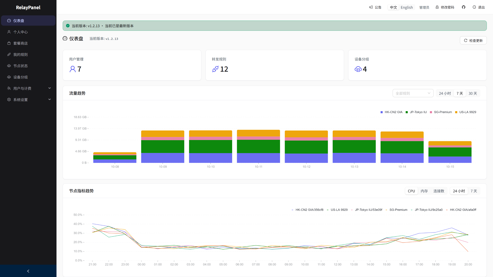
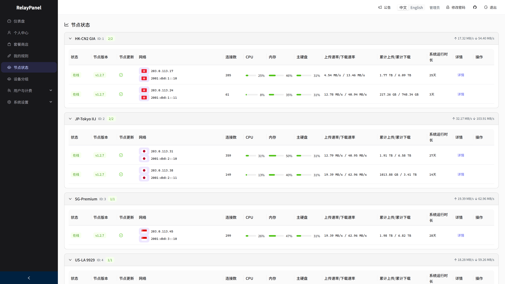
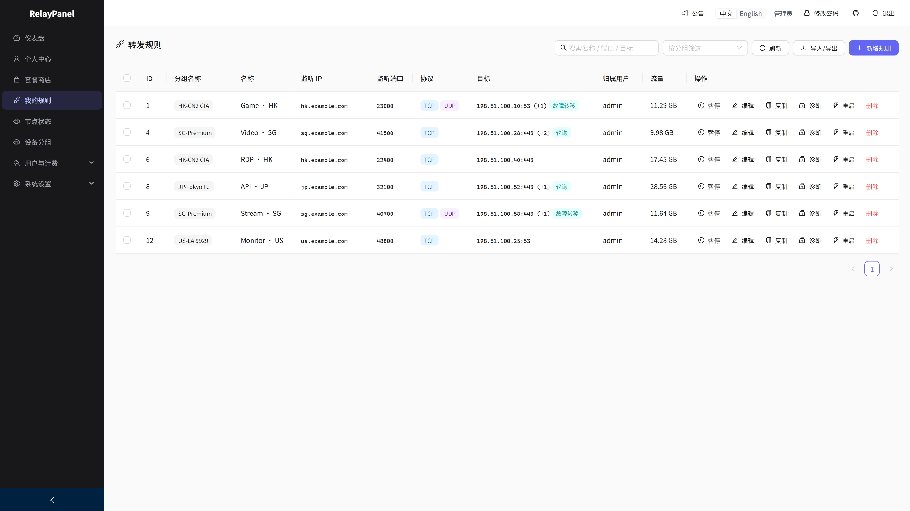
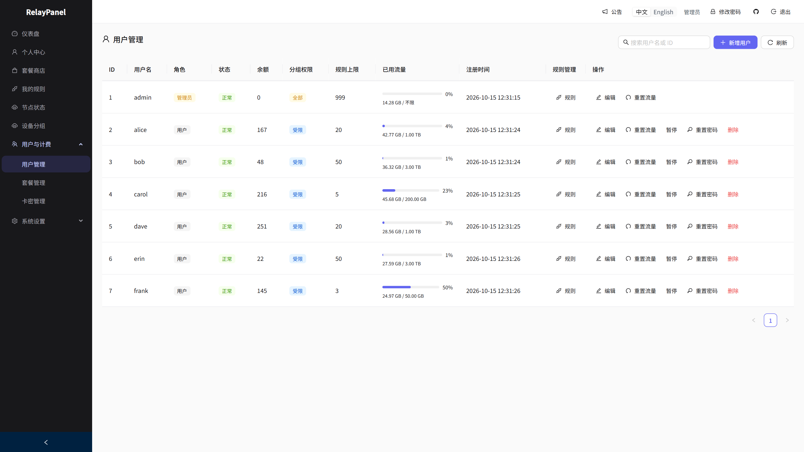
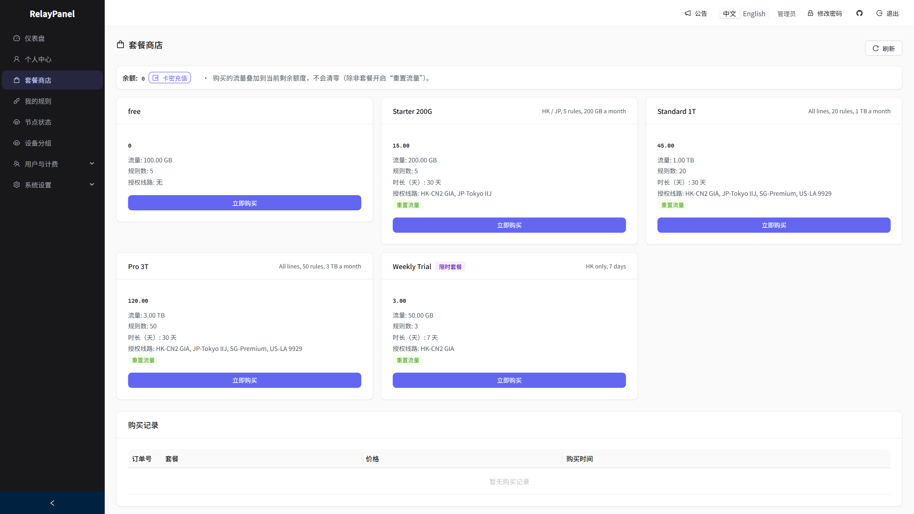
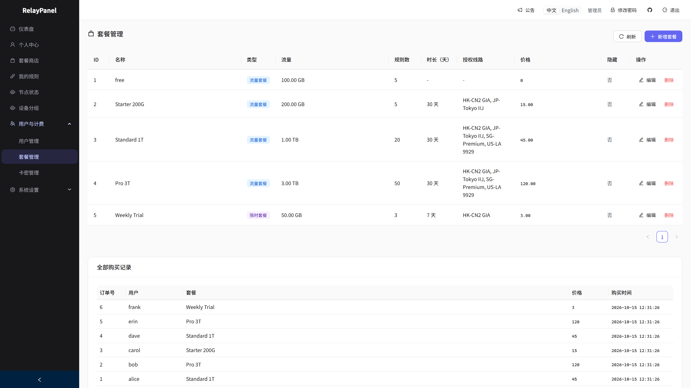

<p align="center">
  
</p>

<h1 align="center">RelayPanel</h1>

<p align="center">
  ⚡ 自托管 TCP/UDP 端口转发管理面板 ⚡
</p>

<p align="center">
  <a href="README.en.md">English</a> | <strong>中文</strong>
</p>

<p align="center">
  <a href="https://github.com/MoeShinX/relay-panel/releases/latest"></a>
  <a href="https://github.com/MoeShinX/relay-panel/actions/workflows/ci.yml"></a>
  <a href="LICENSE"></a>
</p>

<p align="center">
  用 Rust 编写,通过 Web UI 管理转发规则、设备分组、流量配额和实时节点状态。<br/>
  轻量：Panel ~7 MB + Node ~4 MB。部署方式：Docker Compose。数据库：SQLite / PostgreSQL。
</p>

---

## ✨ 功能亮点

- 🔀 **转发规则** — TCP/UDP 多目标转发，故障转移 / 轮询负载均衡，目标熔断自动恢复，域名目标跟随 DDNS；可用 PROXY protocol 把真实用户 IP 传给目标（支持节点套节点）
- 🚦 **连接治理** — 每条规则可设并发连接数上限；支持单条 / 批量 / 定时重启，重启会掐断旧连接并重建监听
- 🛒 **套餐与计费** — 用户自助买套餐、卡密充值余额；按「(上行 + 下行) × 线路倍率」扣额度；一人一个当前套餐，续费叠加、换套餐整体替换
- 📊 **流量可视** — 按规则 / 用户计量，近 1 / 7 / 30 天趋势图按线路分色堆叠，看得出是哪条线路在吃额度
- 🖥️ **节点管理** — 实时 CPU（含型号）/ 内存 / 连接数、地区识别、掉线推送 Telegram 或邮件、面板一键升级节点（免 SSH）
- 👤 **用户与分组** — 管理任意用户的规则与套餐、重置流量密码、封禁；设备分组可隐藏，节点卸载不影响规则
- 🗄️ **部署友好** — SQLite（零配置）或 PostgreSQL；面板与节点均支持 amd64 / arm64；面板手机上也能用
- 🔒 **安全** — 首次登录强制改密码，节点 Bearer Token 鉴权

完整功能说明与使用文档：**[relaypanel.dev](https://relaypanel.dev)**

---

## 🖼️ 界面预览

<table>
  <tr>
    <th width="50%">仪表盘</th>
    <th width="50%">节点状态</th>
  </tr>
  <tr>
    <td><a href="docs/screenshots/zh/dashboard.png"></a></td>
    <td><a href="docs/screenshots/zh/nodes.png"></a></td>
  </tr>
  <tr>
    <th width="50%">转发规则</th>
    <th width="50%">用户管理</th>
  </tr>
  <tr>
    <td><a href="docs/screenshots/zh/rules.png"></a></td>
    <td><a href="docs/screenshots/zh/users.png"></a></td>
  </tr>
  <tr>
    <th width="50%">套餐商店</th>
    <th width="50%">套餐管理</th>
  </tr>
  <tr>
    <td><a href="docs/screenshots/zh/shop.png"></a></td>
    <td><a href="docs/screenshots/zh/plans.png"></a></td>
  </tr>
</table>

<sub>截图中的线路、用户和地址都是演示用的虚构数据。点击图片查看大图。</sub>

---

## 🚀 快速开始

**一条命令部署：**

```bash
curl -fsSL https://raw.githubusercontent.com/MoeShinX/relay-panel/main/install.sh | bash
```

大陆服务器上，GitHub 无法直连时，安装和更新会自动改走下载镜像，无需额外操作。

> 🔑 **首次启动不再使用固定密码：初始 `admin` 密码为随机生成，只在面板日志中打印一次（`docker compose logs panel`）；也可通过环境变量 `ADMIN_INITIAL_PASSWORD` 指定。首次登录强制修改密码。忘记或没看到时，在部署目录运行 `docker compose exec panel relaypanel-entrypoint ./relay-panel reset-admin-password` 重新生成一个。**

📖 完整指南：**[docs/DEPLOYMENT.md](docs/DEPLOYMENT.md)**

---

## 🏗️ 架构

```
  浏览器 (React UI)          relay-node (Tokio TCP/UDP)
       │                          ▲
       ▼                          │
   relay-panel  ◄─── WebSocket 配置推送 + HTTP 状态上报
   (Axum API)                     │
       │                          ▼
   SQLite / PG              转发流量到真实目标
```

---

## 🔄 更新

**面板**：有新版本时，在仪表盘点「马上更新」即可，无需 SSH。使用 SQLite 时会先自动备份数据库到 `backups/`（保留最近 5 份，手动运行 `./deploy.sh` 升级也一样）；使用 PostgreSQL 请先自行备份。更新期间面板约半分钟打不开，节点转发不受影响。

一键更新依赖服务器上的更新服务，它会在手动更新时装好。所以 **v1.2.10 及更早版本需要先手动更新一次**，之后就能一键更新（更新前请备份 `.env` 和数据库）：

```bash
cd /opt/relay-panel && git pull --quiet && ./deploy.sh
```

**节点**：面板 → 节点状态 → 点「升级」，无需 SSH。仅 systemd 节点可用（Docker 节点改为更新镜像）。node-v1.2.5 起，节点重启前会停止接新连接、补报已计数的流量，并给进行中的连接最多 5 秒收尾；长连接（隧道、VPN）仍会断开。详见 [转发节点文档](docs/NODE.zh-CN.md#更新)。

---

## 🛠️ 本地开发

```bash
cargo build && cargo run -p relay-panel &   # API 在 :18888
cd frontend && npm install && npm run dev   # UI 在 :5173
python3 tests/e2e_test.py                   # 端到端测试
```

---

## 📦 技术栈

Rust · Axum · Tokio · sqlx · SQLite/PostgreSQL · JWT · React 19 · TypeScript · Ant Design · Docker Compose

---

## 📄 许可证与免责声明

Apache-2.0 —— 详见 [LICENSE](LICENSE)。

开源流量转发工具，**仅供个人学习与研究使用**。请在合法合规前提下使用，风险自负。

完整 **[免责声明](docs/DISCLAIMER.md)**
