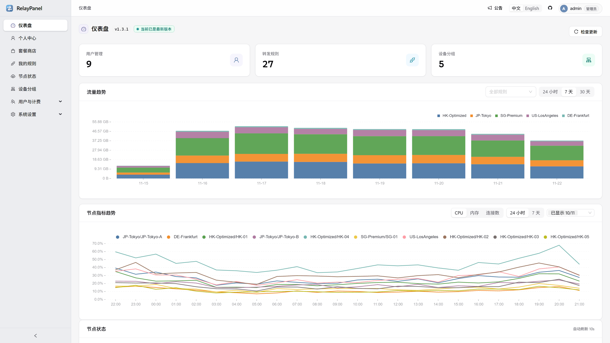
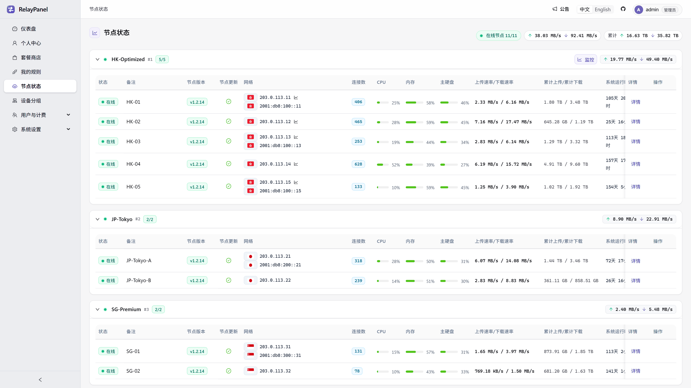
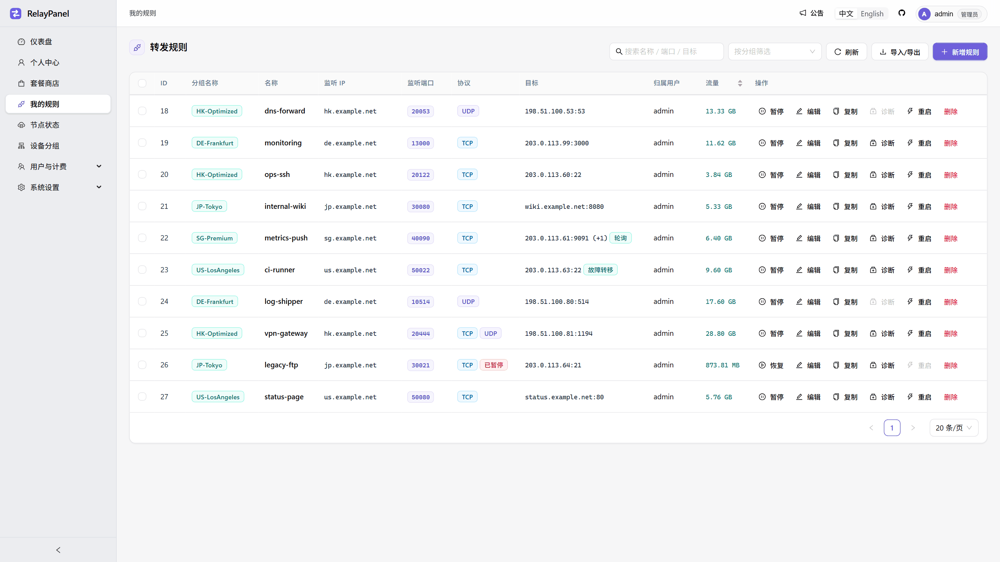
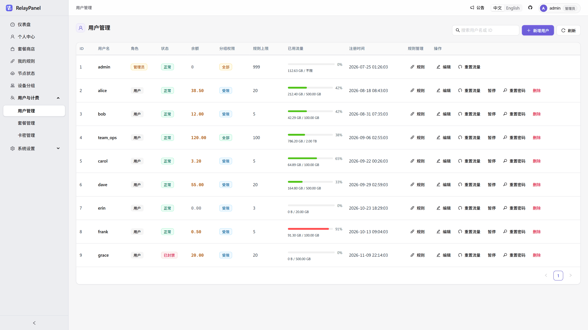
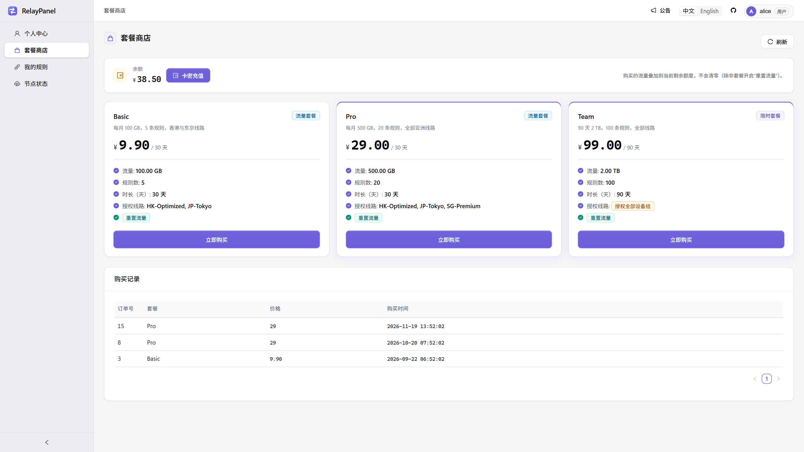
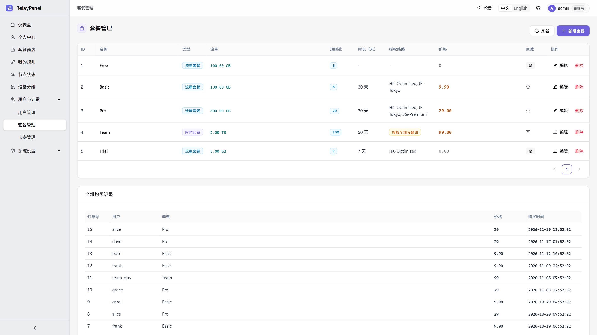
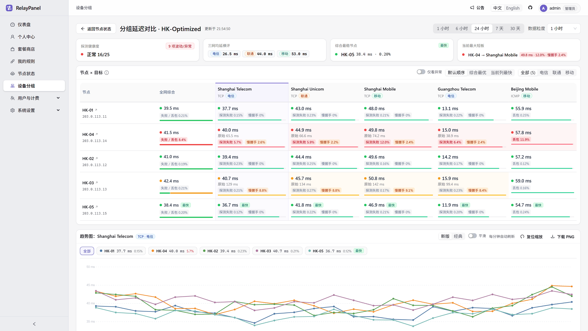

<p align="center">
  
</p>

<h1 align="center">RelayPanel</h1>

<p align="center">
  <strong>自托管 TCP/UDP 端口转发与流量管理面板</strong>
</p>

<p align="center">
  <a href="README.md">English</a> · <strong>简体中文</strong> · <a href="https://relaypanel.dev">使用文档</a>
</p>

<p align="center">
  <a href="https://github.com/MoeShinX/relay-panel/releases/latest"></a>
  <a href="https://github.com/MoeShinX/relay-panel/actions/workflows/ci.yml"></a>
  <a href="LICENSE"></a>
  <a href="https://relaypanel.dev"></a>
</p>

<p align="center">
  基于 Rust 与 React 构建，通过 Web UI 统一管理 TCP/UDP 转发规则、设备分组、流量配额、套餐计费与实时节点状态。<br/>
  <strong>Panel ~7 MB + Node ~4 MB</strong> · Docker Compose · SQLite / PostgreSQL · amd64 &amp; arm64
</p>

---

## 功能特性

### 转发与连接治理
- **多目标 TCP/UDP 转发** — 支持故障转移与轮询负载均衡、目标熔断自动恢复，以及跟随 DDNS 变更的域名目标。
- **PROXY protocol 与多跳级联** — 可将真实客户端 IP 透传给后端目标，支持节点套节点场景。
- **限速与连接控制** — 支持按规则配置上下行限速、并发连接数上限，节点侧统一文件描述符预算；支持一键诊断与单条 / 批量 / 定时重启（断开旧连接并重建监听）。
- **回环访问防护** — 节点侧按 DNS 解析后的真实地址拦截普通用户规则访问本机回环和链路本地地址。

### 节点状态与网络监控
- **实时节点监控** — 查看 CPU（含型号）、内存、磁盘、实时上下行速率、节点转发连接数（管理员还可查看 Linux 主机 TCP/UDP 连接数）、地区识别，以及掉线 Telegram / 邮件告警。
- **免 SSH 一键升级节点** — 在面板中直接升级 systemd 节点，重启前优雅收尾现有连接（最长等待 5 秒）。
- **网络监控（延迟矩阵）** — 按设备分组定时探测三网 TCP / ICMP 延迟、丢包与慢握手；提供健康度概览、综合排名对比矩阵、单节点趋势聚焦与近况色块条。

### 用户、计费与流量分析
- **套餐与计费体系** — 支持用户自助购买套餐与卡密充值余额，按「`(上行 + 下行) × 线路倍率`」扣减额度；每人持有一个当前套餐，续费叠加、换套餐整体替换。
- **流量可视化** — 按规则与用户精准计量，近 1 / 7 / 30 天趋势图按线路分色堆叠，清晰定位流量消耗来源。
- **设备分组与用户管理** — 管理员可管理任意用户的规则、套餐、密码或封禁状态；设备分组可隐藏，卸载或更换节点不影响已有规则。

### 轻量、易部署与安全
- **极简资源占用** — Rust（Axum + Tokio + sqlx）后端与静态节点二进制，支持 `linux/amd64`（兼容无 AVX2 的老款 CPU）与 `linux/arm64`。
- **双数据库支持** — 内置零配置 SQLite（升级前自动备份），也支持 PostgreSQL。
- **HTTPS 与移动端适配** — 内置直连、Caddy 自动签发 HTTPS、以及外部 Nginx/Caddy 反代模式；桌面端与手机端均可操作，支持中英文一键切换。
- **默认安全策略** — 首次启动生成随机初始 `admin` 密码并强制登录修改，采用 JWT 会话、节点 Bearer Token 鉴权与操作审计日志。

完整功能说明与使用文档：**[relaypanel.dev](https://relaypanel.dev)**

---

## 界面预览

<table>
  <tr>
    <th width="50%">仪表盘</th>
    <th width="50%">节点状态</th>
  </tr>
  <tr>
    <td><a href="docs/screenshots/zh/dashboard.png"></a></td>
    <td><a href="docs/screenshots/zh/nodes.png"></a></td>
  </tr>
  <tr>
    <th width="50%">转发规则</th>
    <th width="50%">用户管理</th>
  </tr>
  <tr>
    <td><a href="docs/screenshots/zh/rules.png"></a></td>
    <td><a href="docs/screenshots/zh/users.png"></a></td>
  </tr>
  <tr>
    <th width="50%">套餐商店</th>
    <th width="50%">套餐管理</th>
  </tr>
  <tr>
    <td><a href="docs/screenshots/zh/shop.png"></a></td>
    <td><a href="docs/screenshots/zh/plans.png"></a></td>
  </tr>
  <tr>
    <th colspan="2">网络监控</th>
  </tr>
  <tr>
    <td colspan="2" align="center"><a href="docs/screenshots/zh/latency.png"></a></td>
  </tr>
</table>

<sub>截图中的线路、用户和地址均为演示用虚构数据。点击图片可查看大图。</sub>

---

## 快速开始

### 1. 部署面板

在 Debian / Ubuntu 服务器上运行一条命令（通过 Docker Compose 拉取预构建多架构镜像）：

```bash
curl -fsSL https://raw.githubusercontent.com/MoeShinX/relay-panel/main/install.sh | bash
```

> **提示**：大陆服务器上如无法直连 GitHub，安装与更新脚本会自动切换至下载镜像，无需额外配置。

> **初始管理员密码**：首次启动不再使用固定默认密码。随机生成的 `admin` 密码会在面板日志中打印一次（`docker compose logs panel`），也可通过环境变量 `ADMIN_INITIAL_PASSWORD` 预设；首次登录强制修改密码。如果遗忘或未看到，可在部署目录运行以下命令重新生成：
> ```bash
> docker compose exec panel relaypanel-entrypoint ./relay-panel reset-admin-password
> ```

### 2. 接入转发节点

1. 登录面板，进入 **设备分组** → **新建分组**，复制生成的 **安装命令**。
2. 在转发节点服务器上执行（轻量裸机 systemd 服务，脚本兼顾安装和升级）：

```bash
bash <(curl -fsSL https://raw.githubusercontent.com/MoeShinX/relay-panel/main/scripts/relay-node-install.sh) \
  -t <node-token> -u https://<你的面板域名>
```

HTTPS 反向代理、PostgreSQL 配置或 Docker 节点部署详见 **[docs/DEPLOYMENT.md](docs/DEPLOYMENT.md)**、**[docs/REVERSE-PROXY.md](docs/REVERSE-PROXY.md)** 与 **[docs/NODE.zh-CN.md](docs/NODE.zh-CN.md)**。

---

## 系统架构

```text
  浏览器 (React UI)               relay-node (Tokio TCP/UDP)
         │                                    ▲
         ▼                                    │
    relay-panel   ◄─── WebSocket 配置推送 + HTTP 状态上报 ───┘
     (Axum API)                               │
         │                                    ▼
   SQLite / PostgreSQL                 转发流量到真实目标
```

面板（`v*`）与节点（`node-v*`）采用独立版本轨道发布：面板 UI/API 更新不会中断节点转发，纯节点修复也可单独升级，互不强依赖。

---

## 更新升级

### 面板
有新版本时，在仪表盘点击「**马上更新**」即可，无需 SSH。使用 SQLite 时会自动将数据库备份到 `backups/`（保留最近 5 份，手动运行 `./deploy.sh` 升级同理）；使用 PostgreSQL 请先自行备份。重启期间面板约半分钟不可访问，节点转发不受影响。

手动更新（`v1.2.10` 及更早版本需先手动更新一次以安装更新服务，更新前请先备份 `.env` 与数据库）：

```bash
cd /opt/relay-panel && git pull --quiet && ./deploy.sh
```

### 节点
进入 **节点状态** → 点击「**升级**」（免 SSH，适用于 systemd 节点；Docker 节点直接更新镜像即可）。节点重启前会停止接收新连接、补报已计数的流量，并给进行中的连接最多 5 秒收尾时间（长连接隧道 / VPN 仍会重连）。详见 [转发节点文档](docs/NODE.zh-CN.md#更新)。

---

## 文档导航

| 文档 | 说明 |
|------|------|
| [relaypanel.dev](https://relaypanel.dev) | 完整使用文档与功能指南 |
| [docs/DEPLOYMENT.md](docs/DEPLOYMENT.md) | 面板部署、环境变量、SQLite / PostgreSQL 与备份指南 |
| [docs/REVERSE-PROXY.md](docs/REVERSE-PROXY.md) | Caddy / Nginx 反向代理、HTTPS 与 `PUBLIC_PANEL_URL` 配置 |
| [docs/NODE.zh-CN.md](docs/NODE.zh-CN.md) ([English](docs/NODE.md)) | 转发节点安装、调优、文件描述符上限与升级说明 |
| [CHANGELOG.md](CHANGELOG.md) | 面板版本更新日志（`v*`） |
| [CHANGELOG-NODE.md](CHANGELOG-NODE.md) | 节点版本更新日志（`node-v*`） |
| [CONTRIBUTING.md](CONTRIBUTING.md) | 参与贡献与仓库规范 |

---

## 本地开发

```bash
cargo build && cargo run -p relay-panel &   # API 运行在 :18888
cd frontend && npm install && npm run dev   # UI 运行在 :5173
cargo test --workspace                      # Rust 单元与集成测试
python3 tests/e2e_test.py                   # 端到端测试
```

---

## 技术栈

Rust · Axum · Tokio · sqlx · SQLite / PostgreSQL · JWT · React 19 · TypeScript · Ant Design · Docker Compose

---

## 许可证与免责声明

基于 **Apache-2.0** 协议开源 —— 详见 [LICENSE](LICENSE)。

本项目为开源流量转发工具，**仅供个人学习、研究与合法合规的运维管理使用**。请遵守所在国家与地区的法律法规，使用风险自负。详见完整 **[免责声明](docs/DISCLAIMER.md)**。
